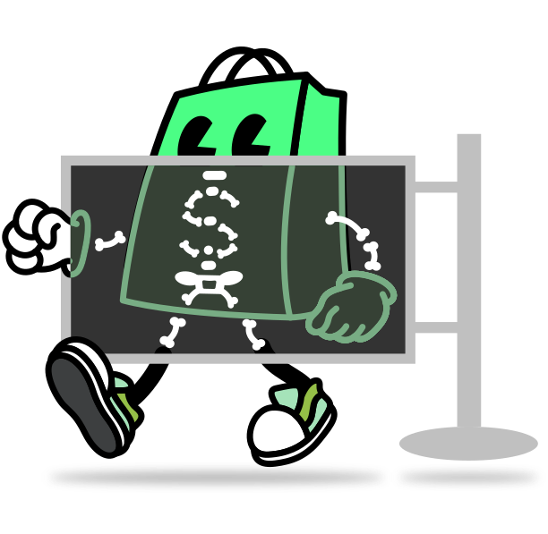

<h1 align="center" style="position: relative;">
  <br>
    
  <br>
  Shopify Skeleton Theme
</h1>

A minimal, carefully structured Shopify theme designed to help you quickly get started. Designed with modularity, maintainability, and Shopify's best practices in mind.

<p align="center">
  <a href="./LICENSE.md"></a>
  <a href="./actions/workflows/ci.yml"></a>
</p>

## Getting started

### Prerequisites

Before starting, ensure you have the latest Shopify CLI installed:

- [Shopify CLI](https://shopify.dev/docs/api/shopify-cli) – helps you download, upload, preview themes, and streamline your workflows

If you use VS Code:

- [Shopify Liquid VS Code Extension](https://shopify.dev/docs/storefronts/themes/tools/shopify-liquid-vscode) – provides syntax highlighting, linting, inline documentation, and auto-completion specifically designed for Liquid templates

### Clone

Clone this repository using Git or Shopify CLI:

```bash
git clone git@github.com:Shopify/skeleton-theme.git
# or
shopify theme init
```

### Preview

Preview this theme using Shopify CLI:

```bash
shopify theme dev
```

### Deploy

From the theme directory, upload a new unpublished theme to Shopify:

```bash
shopify theme push --unpublished
```

Follow the prompts to connect to your store and name the theme. Use the returned preview link to review it before publishing.

To update an existing theme instead, run `shopify theme push` and select it. This overwrites its remote files; selecting the live theme affects your storefront.

To update an existing theme without uploading JSON files, run:

```bash
shopify theme push --ignore "**/*.json" --nodelete
```

Select the theme to update. This skips JSON templates, settings, and locale files, and preserves remote files that are absent locally. Changes to translations or other JSON files must be applied separately.

When you're ready to make an unpublished theme live, run `shopify theme publish` and select the theme. See the [Shopify CLI theme push documentation](https://shopify.dev/docs/api/shopify-cli/theme/theme-push) for more options.

#### Versioning after launch

Use Git for theme code history and Shopify draft themes for preview and rollback. Avoid pushing development changes directly to the live theme.

1. **Mark the first live release.** Name the live theme `Maxie & Moo v1.0.0` and tag the exact Git commit that matches the published code. Push the tag to GitHub. Do not tag a working copy with unreleased changes as `v1.0.0`.
2. **Develop on a branch.** Use `shopify theme dev` for local preview and `shopify theme check` before release. Use a patch version such as `v1.0.1` for a fix or a minor version such as `v1.1.0` for a new feature.
3. **Duplicate the live theme.** In **Shopify Admin > Online Store > Themes**, [duplicate the live theme](https://help.shopify.com/en/manual/online-store/themes/managing-themes/duplicating-themes) and name the draft for the next release, for example `Maxie & Moo v1.1.0`. Note its theme ID and confirm it is unpublished before uploading.
4. **Upload and review the draft.** For code-only changes, use `--only` for each changed file the release needs. For example, replace `DRAFT_THEME_ID` with the duplicate's ID:

   ```bash
   shopify theme push --theme DRAFT_THEME_ID --nodelete \
     --only sections/header.liquid \
     --only sections/logo.liquid \
     --only snippets/site-logo-image.liquid
   ```

   A duplicate starts with the live theme's current Theme Editor settings. A full push from an older local copy can overwrite them. If a release changes templates or settings, merge the relevant changes deliberately rather than overwriting them or skipping all JSON. Before publishing, check for Theme Editor changes made to the live theme since the duplicate was created and carry them over as needed.
5. **Publish and keep a rollback option.** Preview the draft on mobile and desktop, then publish the tested draft and tag its Git commit with the release version. Keep the previous live theme in the Shopify library. To roll back, republish that previous theme; doing so changes the storefront theme, not orders or inventory.

### Measuring storefront performance

For Lighthouse in Chrome, open the development preview and use the mobile preset. For PageSpeed Insights, use the public storefront URL once the theme is live, or a Shopify share preview link that works when signed out. Confirm the tested page is the intended theme. Preview tooling adds requests that customers do not see, so compare scores only under matching conditions and retest the primary domain after publishing.

### Background video

For a landscape video, enable **Show full video** in the Background video section. The section follows the uploaded video's aspect ratio on desktop and mobile instead of cropping it to the fixed height settings. Long overlay text may add space around the video. Leave the setting off to keep the existing fixed-height layout.

### Header logo

The header logo links to the storefront home page. Its **Logo width** setting caps the size; on mobile, the header also leaves space for the menu and cart.

### Section color schemes

In the theme editor, open **Theme settings > Colors** to edit or add reusable color schemes. Three starting schemes are included: white, pale green, and charcoal. Each scheme defines background, optional gradient, text, link, and button colors.

Select a section, enable **Use section color scheme**, and choose its **Color scheme**. The background spans the full section width while content keeps its existing layout. Disable the switch to retain the section's original colors. Image/video overlay text, product status colors, and app-provided styling retain their own controls.

### Section heading typography

Select a section and enable **Customize heading typography** to choose a font and set sizes for its main and secondary headings. Settings apply to the section's own headings and supported theme blocks, not headings in rich text or apps. Leave the switch off to keep the original styling.

### Wide flow selection

Add **Wide flow selection** in the theme editor and select a collection. It displays a full-width carousel with arrows on desktop. On mobile, two mats are visible at a time in a single row, with the next mat peeking in where available; swipe horizontally to see more. Product cards link to their product pages; on hover, the second image replaces the first without cropping. Gaps around it use the solid background colour from the section's colour scheme, or the theme's background colour if no scheme is enabled.

**Featured collection** uses the same background colour for gaps around images shown on hover or while browsing a product card's gallery.

Product galleries, collection product cards, and featured collection carousels use circular previous/next buttons with matching Wide flow chevrons.

### Product display names

Set the product metafield `custom.display_name` to replace the displayed product title on product pages and collection grids. If it is blank, the product title is used.

### Product color picker

In the product template, select a collection in the **Product color picker** block. The picker appears only when the current product belongs to that collection. Available products appear in the collection's order; set its sort order to **Manually** in Shopify to rearrange them. Each swatch uses the product's `custom.colour_swatch_image` metafield, falling back to its product image when unset. Sold-out products are omitted.

The selection applies to every product using that template. Add a picker block for each color collection or use separate product templates. Existing picker blocks need a collection selected after updating the theme.

The selected color swatch and size box use the custom **Add to cart button color** if enabled, otherwise the section's color scheme or the theme's primary button color.

### Product size chart

Size options appear as selectable boxes without prices, all visible on page load and arranged two per row on desktop. Selecting a box updates the product variant, main price, and availability. The selected box uses the primary button color for its border and a 15% tint of that color for its fill.

Select a **Size chart page** in the product section settings. Its link appears right-aligned beside the size label, with a single underline and no arrow. Products without a size option keep a standalone link.

### Informational pages

Pages using the default Page template use one background across the heading and content, with no border around the content. The Page section's colour scheme still controls the background when enabled.

### FAQ page

The page at `/pages/frequently-asked-questions` also hides its heading accent line and horizontal rules.

FAQ accordion blocks have a subtle bottom divider on each item, without a top border.

## Theme architecture

```bash
.
├── assets          # Stores static assets (CSS, JS, images, fonts, etc.)
├── blocks          # Reusable, nestable, customizable UI components
├── config          # Global theme settings and customization options
├── layout          # Top-level wrappers for pages (layout templates)
├── locales         # Translation files for theme internationalization
├── sections        # Modular full-width page components
├── snippets        # Reusable Liquid code or HTML fragments
└── templates       # Templates combining sections to define page structures
```

To learn more, refer to the [theme architecture documentation](https://shopify.dev/docs/storefronts/themes/architecture).

### Templates

[Templates](https://shopify.dev/docs/storefronts/themes/architecture/templates#template-types) control what's rendered on each type of page in a theme.

The Skeleton Theme scaffolds [JSON templates](https://shopify.dev/docs/storefronts/themes/architecture/templates/json-templates) to make it easy for merchants to customize their store.

None of the template types are required, and not all of them are included in the Skeleton Theme. Refer to the [template types reference](https://shopify.dev/docs/storefronts/themes/architecture/templates#template-types) for a full list.

### Sections

[Sections](https://shopify.dev/docs/storefronts/themes/architecture/sections) are Liquid files that allow you to create reusable modules of content that can be customized by merchants. They can also include blocks which allow merchants to add, remove, and reorder content within a section.

Sections are made customizable by including a `` in the body. For more information, refer to the [section schema documentation](https://shopify.dev/docs/storefronts/themes/architecture/sections/section-schema).

### Blocks

[Blocks](https://shopify.dev/docs/storefronts/themes/architecture/blocks) let developers create flexible layouts by breaking down sections into smaller, reusable pieces of Liquid. Each block has its own set of settings, and can be added, removed, and reordered within a section.

Blocks are made customizable by including a `` in the body. For more information, refer to the [block schema documentation](https://shopify.dev/docs/storefronts/themes/architecture/blocks/theme-blocks/schema).

## Schemas

When developing components defined by schema settings, we recommend these guidelines to simplify your code:

- **Single property settings**: For settings that correspond to a single CSS property, use CSS variables:

  ```liquid
  <div class="collection" style="--gap: {{ block.settings.gap }}px">
    ...
  </div>

  
    .collection {
      gap: var(--gap);
    }
  

  
  {
    "settings": [{
      "type": "range",
      "label": "gap",
      "id": "gap",
      "min": 0,
      "max": 100,
      "unit": "px",
      "default": 0,
    }]
  }
  
  ```

- **Multiple property settings**: For settings that control multiple CSS properties, use CSS classes:

  ```liquid
  <div class="collection {{ block.settings.layout }}">
    ...
  </div>

  
    .collection--full-width {
      /* multiple styles */
    }
    .collection--narrow {
      /* multiple styles */
    }
  

  
  {
    "settings": [{
      "type": "select",
      "id": "layout",
      "label": "layout",
      "values": [
        { "value": "collection--full-width", "label": "t:options.full" },
        { "value": "collection--narrow", "label": "t:options.narrow" }
      ]
    }]
  }
  
  ```

## CSS & JavaScript

For CSS and JavaScript, we recommend using the [``](https://shopify.dev/docs/api/liquid/tags#stylesheet) and [``](https://shopify.dev/docs/api/liquid/tags/javascript) tags. They can be included multiple times, but the code will only appear once.

### `critical.css`

The Skeleton Theme explicitly separates essential CSS necessary for every page into a dedicated `critical.css` file.

## Contributing

We're excited for your contributions to the Skeleton Theme! This repository aims to remain as lean, lightweight, and fundamental as possible, and we kindly ask your contributions to align with this intention.

Visit our [CONTRIBUTING.md](./CONTRIBUTING.md) for a detailed overview of our process, guidelines, and recommendations.

## License

Skeleton Theme is open-sourced under the [MIT](./LICENSE.md) License.

